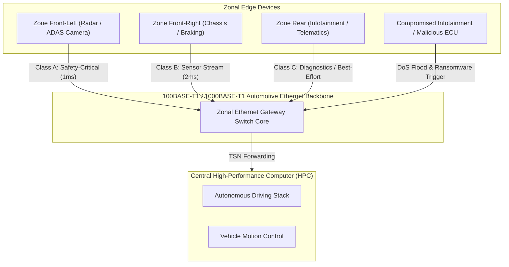

# Zonal Automotive Ethernet Gateway: Attack & Defense Simulation Model

This directory (`D:\caev`) contains a complete MATLAB and Simulink simulation framework for evaluating the resilience of **Zonal Automotive Ethernet Gateways (ZGWs)** against **Denial of Service (DoS)** floods and **Ransomware-induced Host Lockout** attacks.

---

## 1. System & Architecture Overview

In a modern Zonal E/E Architecture, Zonal Gateways aggregate sensor/actuator data from regional subnets (CAN-FD, LIN, FlexRay) and route them over a high-speed Automotive Ethernet backbone (100BASE-T1 / 1000BASE-T1) using SOME/IP, DoIP, and TSN standards.



---

## 2. Attack Vectors Modeled

1. **Denial-of-Service (DoS) Ingress Flooding:**
   - **Mechanism:** Malicious node floods the gateway switch port with unpoliced high-rate traffic ($180\,\text{Mbps}$ on a $100\,\text{Mbps}$ physical link) between $t = 15\,\text{ms}$ and $t = 35\,\text{ms}$.
   - **System Impact:** Gateway buffer memory ($32\,\text{KB}$) fills up, triggering tail-drop packet loss and priority inversion, starving safety-critical control packets.

2. **Ransomware / Host Microprocessor Lockout:**
   - **Mechanism:** Attackers exploit remote telematics or diagnostic services to execute unauthorized code on the gateway microprocessor (e.g. Adaptive AUTOSAR / QNX OS), initiating unauthorized cryptographic encryption routines.
   - **System Impact:** Injected computational latency ($+500\,\mu\text{s}$) and a 50% reduction in gateway forwarding capacity starting at $t = 25\,\text{ms}$, resulting in severe jitter and deadline misses for vehicle chassis control loops.

---

## 3. Defense Mechanisms Modeled

- **IEEE 802.1Qci (Per-Stream Filtering and Policing - PSFP):**
  - Enforces Committed Information Rate (CIR = $25\,\text{Mbps}$) and Committed Burst Size (CBS = $4\,\text{KB}$) via token bucket algorithms at switch ingress.
  - Drops out-of-profile attack traffic before it enters the shared buffer, preventing queue exhaustion.
- **Strict Priority Queuing (SPQ):**
  - Isolates Class A control frames from lower-priority diagnostic and infotainment data.
- **Hardware Security Module (HSM) & Secure Boot Integration:**
  - Enforces cryptographic verification of gateway firmware and prevents persistent ransomware execution.

---

## 4. File Structure in `D:\caev`

| File | Purpose |
| :--- | :--- |
| `parameters.m` | Central configuration defining link rates, buffer sizes, attack windows, and IEEE 802.1Qci token bucket parameters. |
| `build_simulink_model.m` | Programmatically creates and saves the complete Simulink model (`zonal_gateway_model.slx`) with all visual blocks, subsystems, wiring, scopes, and workspaces. |
| `zonal_gateway_core.m` | Discrete-event simulation core calculating queue occupancy, transmission latency, drop ratios, and deadline violations. |
| `run_simulation.m` | Master runner script executing nominal, unprotected, and protected scenarios, generating diagnostic terminal reports and high-resolution comparison plots (`gateway_attack_defense_analysis.png`). |
| `test_model.m` | Automated test suite validating parameter constraints, nominal delivery guarantees, and policing efficiency. |

---

## 5. How to Run

1. Open **MATLAB** and set the current folder to `D:\caev`:
   ```matlab
   cd('D:\caev');
   ```

2. **Run the Full Simulation & Generate Visualizations:**
   ```matlab
   run_simulation
   ```

3. **Generate the Simulink Diagram (`.slx`):**
   ```matlab
   build_simulink_model
   ```
   This will construct and display the block diagram with four primary subsystems:
   - `Traffic_and_Attack_Sources`
   - `IEEE_802_1Qci_Policing_Layer`
   - `Zonal_Gateway_Switch_Engine`
   - `Performance_Monitors_and_Sinks`

4. **Run Unit Tests:**
   ```matlab
   test_model
   ```
